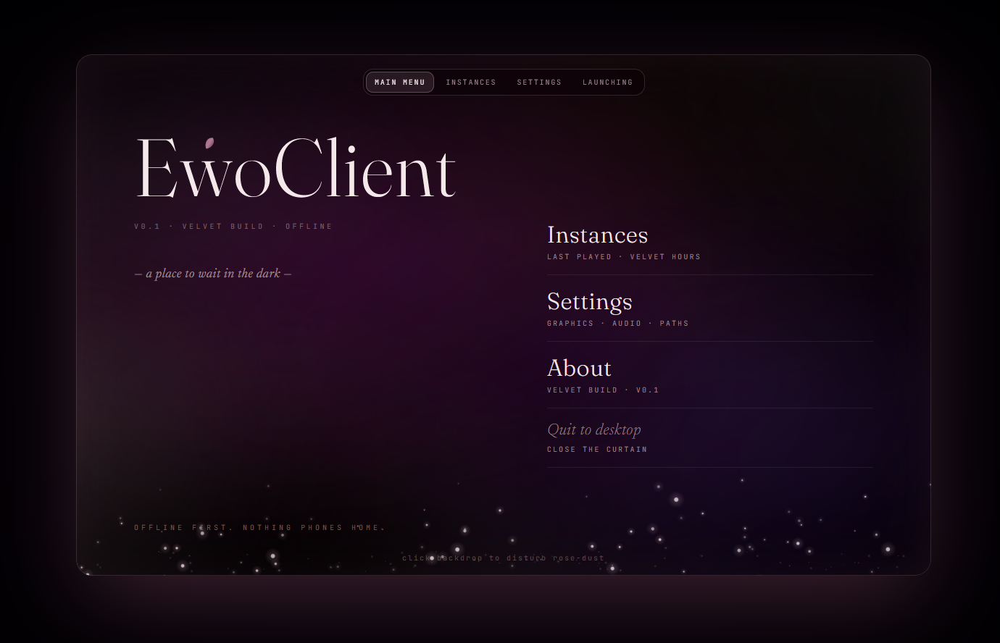
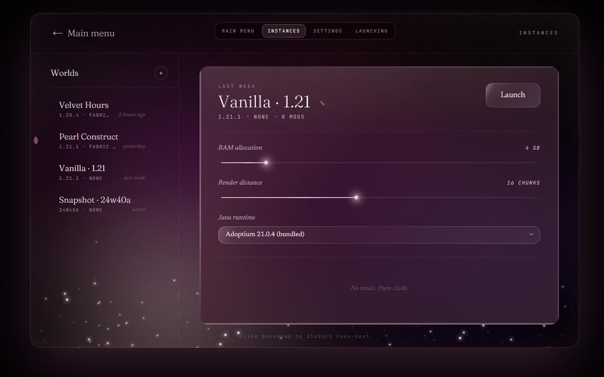
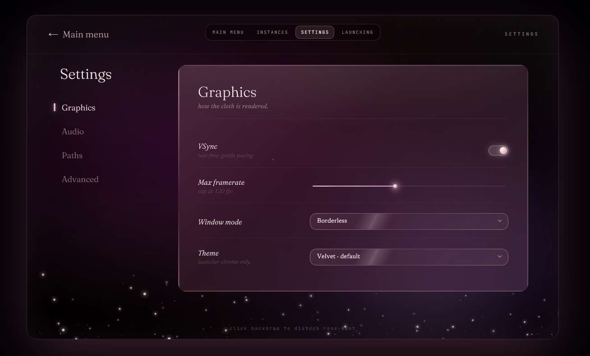
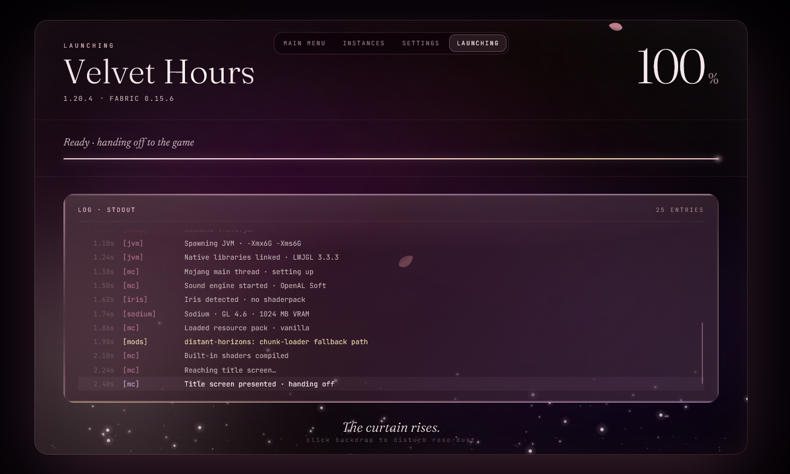

# EwoClient

A custom Minecraft Java Edition launcher with a "Velvet & Pearl" boudoir aesthetic. Native Rust + Skia, custom-frame window, target rendering 500fps on a 500Hz OLED — plus an in-game GUI, a friendly fork of the Fabric loader, and a from-scratch native Minecraft client.

> ⚠️ Personal project. Windows is the developed-and-tested target; Linux/Wayland is written but has never been run on real hardware. macOS and X11 are out of scope.

## Screenshots






## What's done

**The launcher.** A pixel-faithful native port of the CSS prototype — custom-frame transparent window, the full animated backdrop (velvet folds with turbulence + displacement, caustics, bokeh, pearl dust, petals), the glass-panel primitive, every widget and screen, modals, TOML persistence, and a `--dev` overlay with live token tweaks and an FPS HUD.

**It actually launches Minecraft.** Microsoft OAuth → Xbox Live → XSTS → Minecraft Services (the app is on Mojang's allowlist and sign-in is verified live), the real version manifest with sha1-verified library/asset downloads into Mojang's own disk layout, JRE detection with automatic Adoptium fetch, and JVM spawn with stdout/stderr streaming into the launching screen.

**EwoLoader** — a friendly fork of `fabric-loader` (sibling repo) that ships 17 user-toggleable mods plus infrastructure, with per-instance toggles wired end to end.

**An in-game GUI.** A Rust/Skia HUD rendered over the running game from a `cdylib` on its own GL context: FPS/coords/ping/keystrokes/armor/potions/target, a draggable editor, a custom crosshair, an SMTC media controller, a 3D skin viewer, and a multi-tab dashboard — plus client *modules* (12 legit ones by default; a separate `--features pvp` build carries the packet-touching assist set).

**Accounts, profiles and social.** Multi-account, hot-swappable client profiles, a remappable keybind registry, and friends/presence integrated with the user's own Minecraft network.

**[Rewo](REWO_PLAN.md)** — a from-scratch native Minecraft client, in the same workspace under `crates/rewo-*`. It speaks the vanilla protocol (26.2 / protocol 776) and renders with raw Vulkan via `ash`, no JVM and no mod loader. It plays online: signed chat, real skins, OptiFine CEM packs rendered natively, a server-exact client light engine, vanilla's lightmap and day/night sky, per-biome colour, real Nether/End dimensions, 88 mob models with their exact animations, the combat and block-entity arcs, weather and particles — and the whole GUI half: the inventory with its 3D player preview, the first-person hand, 25 container screens, item tooltips and durability bars, the recipe book end to end, and chat — the wrapped, fading HUD box, the screen you type into, a command line with local Brigadier parsing, autocomplete, syntax highlighting and usage hints for every vanilla argument type, translated text (join and death messages and command feedback read as English rather than as `multiplayer.player.joined`), and styled text (a message is a list of styled spans from the wire to the glyph, so a server's colours survive the wrap and bold / italic / underline / strikethrough / obfuscated all draw). Chat is now decorated the way its chat type says (`<Steve> hi`, and a `/msg` in its grey italic), its links are clickable, the command line reports its parse errors, and both scoreboard surfaces draw — the sidebar and the **tab list** you hold Tab for, which since M155 carries its players' 8x8 faces and a `RenderType::HEARTS` health column with vanilla's blink clock. The dark-GUI arc is closed too: the advancements tree (M177–M180, clicks included), the written-book reader with clickable page text, the sign editor, the volume sliders, the survival gauges and the leash rope all draw and respond like their vanilla counterparts. Verified headlessly by a pinned set of serverless gate commands (`tools/gates.py`), each fail-closed with Vulkan validation on, plus a `live --render-check` that drives the *windowed* client against a real server.

## What's next

Rewo's current state, open items and numbers are in [`REWO_PLAN.md`](REWO_PLAN.md) §0.0 (its numbers block is generated by `tools/numbers.py`); the latest audit and its fix status are in [`docs/AUDIT-2026-10.md`](docs/AUDIT-2026-10.md). The audio listening pass is still a human's job: no gate opens an audio device. Packet coverage is the machine-checked table in [`REWO_PACKET_COVERAGE.md`](REWO_PACKET_COVERAGE.md); [`REWO_FEATURE_SURVEY.md`](REWO_FEATURE_SURVEY.md) is the feature roadmap. For the launcher: Hyprland verification and a formal pixel-parity pass vs `style/*.png`.

Start with [`CLAUDE.md`](CLAUDE.md), the index (non-negotiables, locked architecture, where each subsystem's rules live in `.claude/rules/`); history and reasoning are in [`docs/`](docs/README.md).

## Build

```
cargo run --release -p ewo-launcher           # normal launch
cargo run --release -p ewo-launcher -- --dev  # with dev overlay
cargo run --release -p rewo-app -- live --host HOST --port PORT   # the native client
```

Requires Rust 1.89+ (`rust-version` in `Cargo.toml`; CI checks it). First build is slow because Skia compiles its own C++ stack (prebuilts are used; ~30s on a recent machine).

## Stack

- **Rust** (single-threaded, no async runtime)
- **Skia** (`skia-safe` 0.78) — all 2D rendering; D3D12 + DirectComposition on Windows, GL on Linux
- **winit** 0.30 — windowing, custom frame
- **glutin** 0.32 — GL context (Linux)
- **ureq** + **tiny_http** + **opener** — Microsoft auth chain (loopback OAuth flow)
- Variable fonts: Fraunces (display), Newsreader (body), JetBrains Mono (mono)
- **ash** 0.38 (Vulkan 1.3) — raw Vulkan, for the Rewo native client (`crates/rewo-*`)

## License

Source: [MIT](LICENSE).

Bundled fonts are SIL Open Font License (Fraunces, Newsreader, JetBrains Mono) — see `LICENSE` for attribution details.
